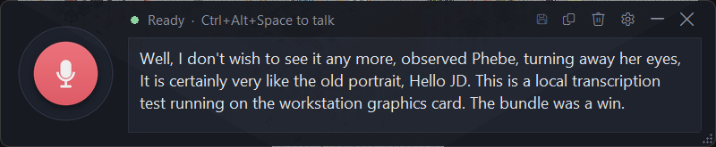

<p align="center">
  
</p>

<p align="center">
  
</p>

<h3 align="center">Private, offline speech-to-text for Windows: live dictation and batch transcription on your own GPU.</h3>

<p align="center">
  <a href="#quick-start">Quick start</a> ·
  <a href="#features">Features</a> ·
  <a href="#how-it-works">How it works</a> ·
  <a href="#privacy">Privacy</a> ·
  <a href="#credits">Credits</a>
</p>

<p align="center"><sub>A <b>Wet Wafer Works</b> project 💜🧡</sub></p>

---

Eagle Ear is a small floating dictation box. You speak, the text appears, and the whole box is already on your clipboard, ready to paste into a chat, an editor or any other app. It also transcribes audio and video files to text and subtitles.

Everything runs on your machine with **NVIDIA Parakeet TDT 0.6B v2**, through NVIDIA NeMo, inside WSL. There's no cloud service, no account and no token.

<p align="center">
  
</p>

## Features

- **Live dictation.** Click the round button or press `Ctrl+Alt+Space` from any app. Each time you pause, that stretch of speech is transcribed and added to the box, with a live preview while you talk.
- **Always on the clipboard.** The box auto-copies after every new piece of text and after you edit. A "Copied" flash confirms it.
- **A fresh message after pasting.** Once you've pasted somewhere else, the next recording starts a new message. `Ctrl+Z` or *Restore last message* brings the old one back.
- **Stays out of your way.** It's an always-on-top tool window with no taskbar button. The hotkey can show it without taking keyboard focus, and it hides to the tray.
- **GPU-aware.** The model stays hot on the GPU (~1.4 GB VRAM). It parks to RAM automatically while a game or another heavy GPU app runs, then comes back about 2 s after that app closes.
- **Fast restarts.** Quitting keeps the model server alive for 90 s, so a restart is ready in about a second.
- **Batch transcription.** Turn any file ffmpeg can read into `.txt` and timestamped `.srt`. Long recordings are cut at silences to fit a 4 GB GPU.
- **Text toggles.** *No punct* strips punctuation but keeps apostrophes inside words like *don't*, and it's on by default. *Leet* and *aLtCaPs* are there for fun.

## Requirements

| | |
|---|---|
| OS | Windows 10/11 with WSL 2 (Ubuntu 24.04) |
| GPU | NVIDIA, 4 GB VRAM or more (tested on an RTX 3050 Ti Laptop). A slow CPU mode is available. |
| Widget | Windows Python 3.14 (tkinter + ctypes) and the pins in `widget/requirements.txt` |
| Model | `nvidia/parakeet-tdt-0.6b-v2` (CC-BY-4.0), about 2.3 GB |

## License

MIT for the Eagle Ear code, see [LICENSE](LICENSE). The Parakeet model is CC-BY-4.0 and isn't included in this repo.

## Quick start

1. **Set up the WSL side.** It installs into `/opt/parakeet`, so nothing touches Windows Python, the Windows CUDA toolkit or the driver:
   ```bash
   wsl -d Ubuntu-24.04 -u root
   bash tools/setup-nemo.sh      # venv with torch + NeMo
   bash tools/fetch-model.sh     # downloads the Parakeet model
   bash tools/deploy-to-wsl.sh   # copies the server and batch scripts to /opt/parakeet/scripts
   ```
2. **Set up the widget venv** on Windows:
   ```powershell
   py -3.14 -m venv widget\.venv
   widget\.venv\Scripts\python.exe -m pip install -r widget\requirements.txt
   ```
3. **Run it:**
   ```powershell
   widget\.venv\Scripts\pythonw.exe widget\eagle_ear.pyw
   ```
   Only one copy runs. Launching it again shows the existing window.

### Batch transcription

```powershell
batch\Transcribe-WithGpuHold.ps1 "$env:USERPROFILE\Videos\meeting.mp4"
```

This writes `meeting.txt` and `meeting.srt` next to the input. If the widget is running, it first parks the widget's model in RAM for the whole job and releases it afterwards, even after an error or `Ctrl+C`.

| Option | Meaning |
|---|---|
| `-OutDir <folder>` | Write the outputs somewhere else |
| several paths | Transcribe a batch with one model load |
| `-ChunkMin 3` | Force 3-minute pieces |
| `-LocalAttn on/off/auto` | Limited-context attention (auto turns it on for audio over 4 min) |
| `-Cpu` | Run on the CPU |
| `-CudaGraphs` | Turn NeMo's CUDA-graph decoder back on (it's off on purpose, see below) |

### Command line

`pythonw eagle_ear.pyw --cmd show|hide|toggle|load|unload|record|prewarm|standby|pausepark|quit|quitall` talks to the running copy.

## How it works

```
widget/   Windows tray app: tkinter UI, mic capture, clipboard, GPU auto-park
server/   WSL live server + fast fp16 checkpoint loader and page-cache prewarm
batch/    File transcription (transcribe.py in WSL + PowerShell wrappers)
bridge/   Optional localhost bridge that lets a local web page receive dictation
tools/    Setup, deploy, profiling and debug helpers
tests/    End-to-end, server, sandboxed GUI and unit tests
docs/     Brand assets and screenshots
```

**Fitting in 4 GB of VRAM:** the encoder runs in bf16. Audio up to 4 minutes gets one full-attention pass (~2.6 GB peak). Longer audio switches to local attention and is cut into ~5-minute pieces at silences (~2.2 GB peak at any length), and the timestamps are offset so the `.srt` covers the whole file. In our tests a 14.5-minute file took 17 s, about 51× real time.

**Known NeMo 3.0.0 workarounds:**
- The CUDA-graph TDT decoder crashes under WSL on the second file of a batch, so it's off.
- Subsampling conv chunking stays at 1.
- Layers rebuilt in fp32 after an attention switch are cast back to bf16.

## Privacy

- Audio never leaves the machine. The live server listens on localhost only and requires a per-session secret.
- Training-data capture is **off by default**. If you turn on *Save training data* (gear or tray menu), clips are saved outside the repo in the folder set by `data_dir` in `widget/config.json` (or `EAGLE_EAR_DATA`).
- `.gitignore` blocks audio, transcripts, manifests and model files from ever being committed.

## Credits

- **Speech model:** [NVIDIA Parakeet TDT 0.6B v2](https://huggingface.co/nvidia/parakeet-tdt-0.6b-v2), licensed under CC-BY-4.0, run through [NVIDIA NeMo](https://github.com/NVIDIA/NeMo).
- **Brand art:** the Eagle Ear badge, banner and wordmark were made by **CloudAtlas** for Wet Wafer Works. The fonts are Orbitron and Saira (SIL OFL 1.1). See [`docs/brand/`](docs/brand/README.md).
- **Built by the Wet Wafer Works consortium:** executive direction, vision and verification by JD; systems architecture by Archie; implementation and profiling by Cortana.

<p align="center">
  
</p>
